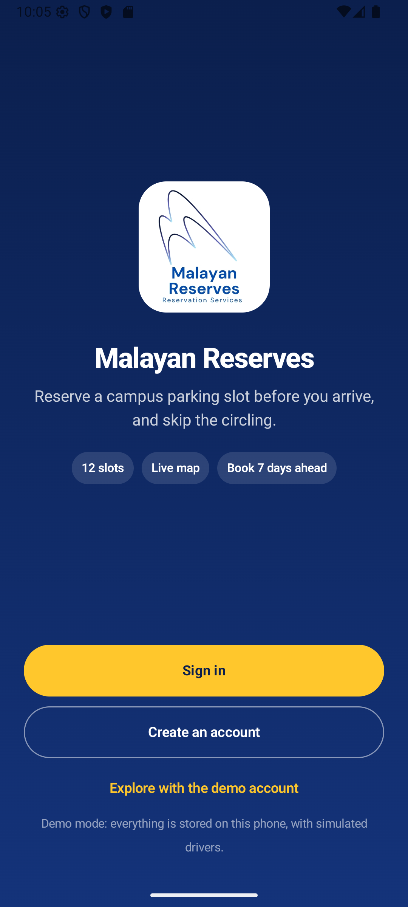
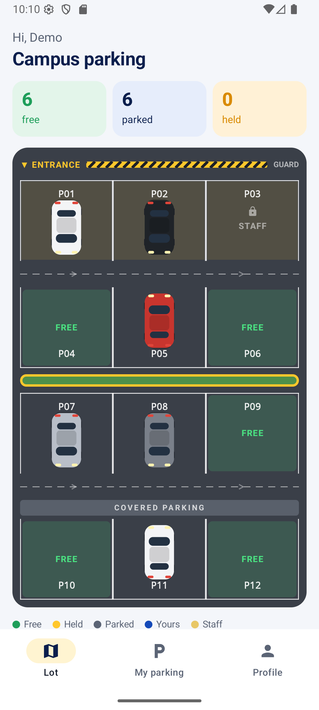
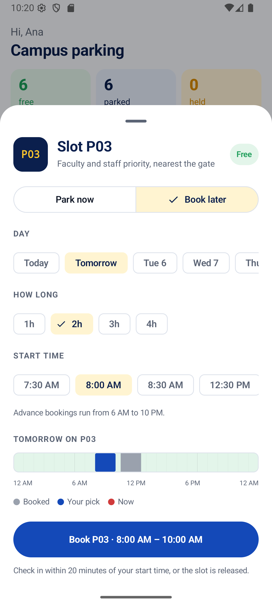
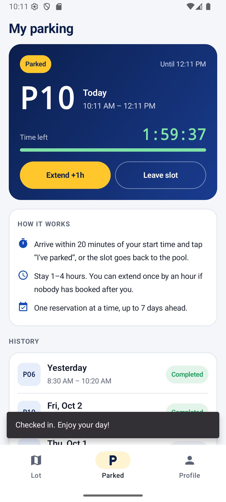

# Malayan Reserves

A campus parking reservation app for Android. Drivers see a live map of the lot, park in a free slot right away or book one up to seven days ahead, check in when they arrive, and free the slot when they leave.

**Try it in your browser:** [interactive web demo](https://yowhann321.github.io/MyPersonalWebsite/projects/malayan-reserves/)

> A student project concept. It is not an official Mapúa Malayan Colleges Laguna service.

<p>
  
  
  
  
</p>

## Team

Originally our Machine Problem for Integrative Programming.

- Johann Lijauco (lead programmer)
- Mikhail David
- Zei Ramirez
- Austine Ang
- Angelo Ebrada

## Features

- **Live lot map.** Twelve slots in four rows, drawn as a real lot. Each parked car appears in its owner's car color. The map refreshes every 10 seconds.
- **Park now or book later.** Pick a duration (1 to 4 hours) and, for later, a day and a start time. A timeline shows when the slot is already booked.
- **Arrival window.** A slot is held for 20 minutes from its start time. Tap "I've parked" to check in, or the slot is released as a no-show.
- **Extend or leave.** Extend once by an hour if nobody has booked right after you. Leaving frees the slot for the next driver immediately.
- **Fair use.** One reservation per driver at a time. Slots P01–P03 are kept for faculty and employees. Advance bookings run from 6 AM to 10 PM.
- **Privacy.** Other drivers only see part of your plate (for example `ABC ••34`).
- **Accounts.** Sign up with a `@live.mcl.edu.ph` email, then add your vehicle type, color and plate. You can edit the vehicle later.
- **Demo mode.** Without a server, the app runs on an on-device database with simulated drivers who arrive, leave and book ahead.

## What changed from the original version

The first version of this group project, our Machine Problem for Integrative Programming, was a single-screen Jetpack Compose prototype with a small PHP backend. This version is a full rewrite that fixes these problems:

| Problem in the original | Fix |
| --- | --- |
| The project didn't build: a literal `<compose_version>` placeholder in a dependency, a wrong `Visibility` import, and a lint artifact added as a library | Clean Gradle setup with a version catalog and current Compose libraries |
| Registration never moved on: the app waited for `"inserted"` but the server replied `"success"` | JSON API with clear `ok` / `error` responses |
| Slot details never loaded: the query joined a user ID to an email and filtered a slot ID by its name | Slot state is computed from reservations in one query |
| Slots stayed taken forever: reservations were never cleared, and later bookings never started | Reservations move through Upcoming → Held → Parked → Completed (or No-show / Cancelled) as time passes |
| The app marked a slot reserved even when the server returned an error | The UI only updates after the server confirms |
| One driver could reserve several slots, and overlapping or past times were accepted | One live reservation per driver, overlap checks inside a database transaction, and validated start times |
| Car type was optional in the app but required by the server | Both sides validate the same fields |
| `login.php` closed an undefined variable | Rewritten API |
| Passwords were stored and sent in plain text, inside URLs | Passwords are hashed (`password_hash` on the server, PBKDF2 in demo mode) and only sent in POST bodies; sessions use random tokens stored as hashes |
| The server address was hard-coded to one computer's IP | The address is set in `local.properties`; without it, the app runs in demo mode |
| No database schema was included | `backend/schema.sql` creates the tables and seeds the slots |
| Zooming scaled the whole screen, including the navigation bar | Redesigned layout with a bottom navigation bar and a scrollable map |
| Everyone could see every full plate number | Plates are masked for other drivers |

## Project structure

```
app/src/main/java/com/example/malayanreserves/
  data/Model.kt              data classes
  data/Rules.kt              parking rules shared by the app and the demo database
  data/ParkingRepository.kt  what the app needs from a backend
  data/LocalRepository.kt    demo mode: SQLite on the device, plus simulated drivers
  data/RemoteRepository.kt   talks to the PHP API
  AppViewModel.kt            app state, clock and refresh
  ui/                        Compose screens: sign-in, lot map, booking sheet, my parking, profile
backend/
  api.php                    JSON API (PDO, transactions, hashed passwords and tokens)
  config.php                 database settings (or environment variables)
  schema.sql                 tables and slot data
```

## Running the app

Open the project in Android Studio and run the `app` configuration. Requirements: Android 11 (API 30) or newer.

By default the app starts in **demo mode**. Tap "Explore with the demo account", or create your own account on the device.

## Running with the PHP backend

1. Install [XAMPP](https://www.apachefriends.org/) (or any PHP 8 + MySQL/MariaDB server).
2. Import the database: open phpMyAdmin and import `backend/schema.sql`, or run `mysql -u root -p < backend/schema.sql`.
3. Copy the `backend` folder to `C:\xampp\htdocs\malayan-reserves`.
4. Set the database login in `backend/config.php`, or with the environment variables `MR_DB_HOST`, `MR_DB_PORT`, `MR_DB_NAME`, `MR_DB_USER` and `MR_DB_PASS`.
5. Point the app at the server by adding this line to `local.properties`:

   ```
   api.baseUrl=http://10.0.2.2/malayan-reserves
   ```

   `10.0.2.2` is your computer as seen from the Android emulator. To use a real phone on the same Wi-Fi, use your computer's LAN address instead, and add that address to `app/src/main/res/xml/network_security_config.xml` (plain HTTP is only allowed for listed development hosts).

6. Rebuild and run the app. The demo account button disappears in server mode.

### API

Every call is a `POST` to `api.php?a=<action>` with a JSON body. After signing in, send `Authorization: Bearer <token>`.

| Action | Body | Returns |
| --- | --- | --- |
| `register` | `name`, `email`, `password`, `type`, `vehicle {type, color, plate}` | `token`, `user` |
| `login` | `email`, `password` | `token`, `user` |
| `logout`, `me` | none | `user` (for `me`) |
| `vehicle` | `vehicle {type, color, plate}` | `user` |
| `lot` | none | `now`, `slots[]` with state, masked vehicle and bookings |
| `mine`, `history` | none | `reservation` / `reservations[]` |
| `reserve` | `slot`, `start` (epoch ms; now or earlier means park now), `duration` (minutes) | `reservation` |
| `arrive`, `extend`, `end` | none | `reservation` |

Errors come back as `{"ok": false, "error": "message"}` with a matching HTTP status.
